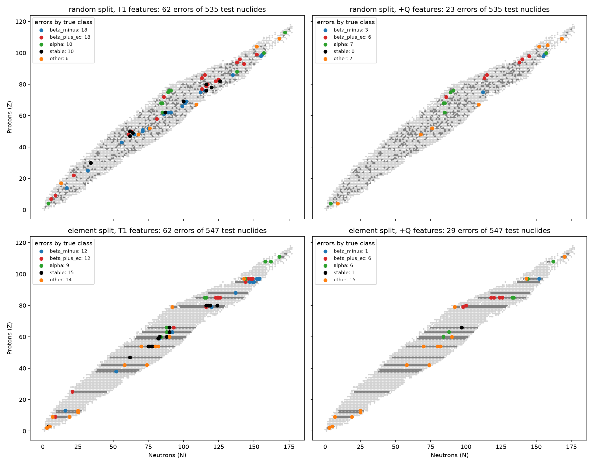
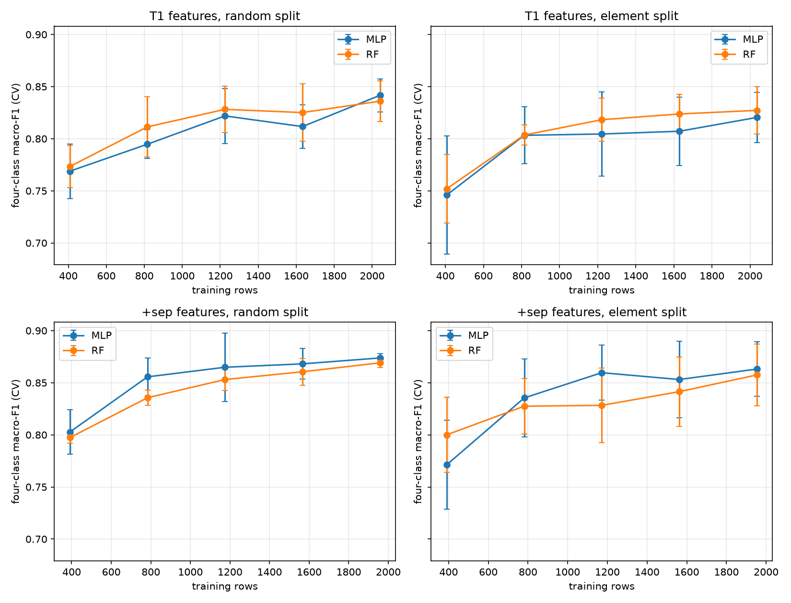

# Predicting Nuclide Decay Mode From Nuclear Structure


## Summary

**Question:** Can a model predict how a nuclide's ground state primarily decays (beta-minus, beta-plus/EC, alpha, stable, or other) from its proton and neutron counts, and what do mass-derived energies add?

**Data and approach:** 3,191 nuclides from the IAEA Live Chart of Nuclides excluding columns that would leak the answer (half-lives, branching ratios, and columns whose missingness reveals the label). I compared a tuned random forest with a PyTorch MLP, using two test splits: a stratified random split and an element split in which all isotopes of an element are held out together, to test generalization to unseen elements. Models were chosen with cross validation; each test set was scored twice, once with a single seed pass and then again with a five seed-averaged pass.

**Key results** (four-class macro-F1 over beta-minus, beta-plus/EC, alpha, and stable; Tier 1 features, all test rows):
- Proton and neutron counts plus simple derived features reach about 0.85 to 0.86 on the random split and 0.83 to 0.87 on unseen elements. Including the small "other" class, five-class macro-F1 is about 0.80 on the random split and 0.74 to 0.78 on unseen elements.
- The MLP and the forest are roughly tied. Neither wins consistently across splits and feature sets and differences are within noise.
- Even/odd parity of Z and N is the most valuable engineered feature (+0.06 to +0.09); distance to the nearest magic number adds nothing measurable.
- Decay Q-values lift both models by +0.06 to +0.10 (stable F1 from about 0.7 to 0.9+), and separation energies add a smaller, less consistent gain. Q-values nearly restate which decays are energetically allowed, so they are a ceiling experiment and not a like-for-like comparison.
- Learning curves flatten after about 1,000 training rows; the limit looks set by the features and by ambiguity in decay modes, not by sample size.

**Limitations:**
- The test sets are small (about 640 rows, with 35 to 36 "other"), so intervals are wide (about +/-0.03 to 0.07), and results for "other" are indicative only.
- "Other" mixes unrelated decay modes (proton emission, fission, double beta, delayed emission), and the rarer ones are essentially never predicted correctly.
- About a quarter of the mass-derived values are extrapolated rather than measured; the energy results were checked on measured masses only and held up.
- The element split still has neighboring elements in training, so it tests unseen elements but not unseen regions of the chart.
- Hyperparameters were chosen on Tier 1 features and then frozen for the Tier 2 experiments, which may disadvantage the MLP. 151 nuclides with a decay mode but no measured half-life were excluded.

Details, tables, and all intermediate results are below.


## Data Information

Source: IAEA Nuclear Data Section, Live Chart of Nuclides (ground-state table)
URL: https://nds.iaea.org/relnsd/v1/data?fields=ground_states&nuclides=all
Downloaded on 10/12/2026 manually through a browser (the API rejects scripted requests); each file contains an extraction date column as well for traceability
Contains 3,386 nuclides with 55 columns; raw file included in git, so no download is needed to reproduce

## Setup

- Python 3.14.7, virtual environment in `.venv/`
- Install PyTorch separately from pytorch.org, choosing the build that matches your GPU (newer GPUs need newer CUDA builds; the CPU build also works at this dataset size), then run `python -m pip install -r requirements.txt`
- Run scripts from the project root, e.g. `python src/get_data.py`

## File Setup

```
MLNuclearPhysics/
├── data/raw/                  # untouched download (included in git)
├── results/                   # CSVs: searches, ablations, importance, final evaluation
├── figures/                   # learning curves, error chart
├── src/
│   ├── get_data.py            # load data, build labels
│   ├── features.py            # Tier 1 features, load_main_dataset()
│   ├── split.py               # random and element train/test splits
│   ├── baselines.py           # majority class, logistic regression, random forest
│   ├── error_analysis.py      # per-class errors of the default forest
│   ├── mlp.py                 # PyTorch MLP and training loop
│   ├── mlp_cv.py              # MLP cross validation
│   ├── tune_mlp.py            # MLP random search
│   ├── tune_rf.py             # random forest random search
│   ├── compare.py             # repeated-CV model comparison
│   ├── tier2_check.py         # missingness and units check for the energy columns
│   ├── tier2.py               # Tier 2 ablation (cross validation)
│   ├── other_modes.py         # "other" class by sub-mode
│   ├── final_eval.py          # test-set evaluation: 5 seeds, bootstrap, paired contrasts
│   ├── feature_ablation.py    # Tier 1 feature groups
│   ├── importance.py          # permutation importance by feature group
│   ├── learning_curves.py     # learning curves
│   └── error_chart.py         # chart of test-set errors
├── requirements.txt
└── README.md
```

## Target and its labels

Target: the primary decay mode of the nuclide, 'decay_1' in the data; expected in 5 classes so results are concise yet still meaningful

1. beta_minus; B-; 1,344 appearances in data
2. beta_plus_ec; EC+B+, EC, B+; 1,082 appearances in data
3. alpha; A; 479 appearances in data
4. stable; STABLE; 244 appearances in data
5. other; P, N, SF, double decays, delayed emission, etc.; 193 appearances in data

Counts above are for all 3,342 labeled rows. The main dataset (measured half-life only, 3,191 rows) has: beta_minus 1,225 / beta_plus_ec 1,070 / alpha 473 / stable 244 / other 179.

Notes regarding specific target outcomes:
- For value 2. I grouped the 3 types of decay as one because they all represent the same process (proton to neutron).
- For value 4. I check if a nuclide is STABLE in the data first, since some rows do actually have a decay_1 value yet decay so slowly they are treated as STABLE
- For value 5. I group all rare types of decay since there are not enough rows to evaluate (some decays only had 1 row)
- 44 rows were dropped due to having no decay_1 value, yet they do have a half-life so they can't be grouped as stable

## Data notes and exclusions

- Columns: half-life, decay branching, and uncertainty have an immediate relationship with decay and are thus excluded. Furthermore, columns: abundance, radius, and nuclear moments are only filled for long-lasting nuclides, so even their missingness reveals the label, and they are also dropped. Columns with few entries are also dropped
- Some nuclide masses appear to be estimated from systematics rather than measured (interpreting `me_systematics == 'Y'` in the data this way, based on the column name and pattern, not documentation). None of the stable nuclides have estimated masses, so we eliminate this column along with the mass uncertainty columns as features. It is kept only as an evaluation flag. Evaluation was repeated on measured-mass rows only (see 6. and 7.)
- 151 labeled rows have a decay mode but no measured half-life. 119 of them also have estimated masses and 119 are beta-minus, which suggests these modes are assumed or predicted rather than directly observed (my inference from the pattern, not stated by the database). Their labels are less reliable, so they are excluded from training and testing. Comparing the model's predictions against their listed modes is left as possible future work

## Project Approach

1. Dataset: 3,191 rows with a measured half-life
2. Main (Tier 1) features: Z, N, A (mass number, Z + N), N-Z, neutron fraction, even/odd parity of Z and N, distance to nearest magic number
    - Ensured in features.py testing that beta_minus nuclides had higher neutron fraction, alpha emitters had largest mass number, and the majority of stable nuclides are even-even. These are all commonly accepted nuclear physics principles, checked to confirm our data relatively fits assumptions
3. Establishing Train/Test split: Set aside 20% of data as test (stratified by label), then train on the remaining 80% using 5 fold cross validation
    - Some isotopes are near identical (Sn-120 and Sn-121), so I experimented with two different kinds of splits. RANDOM split is a traditional split that is purely random in separating train and test data. ELEMENT split addresses the similar isotope issue by sending all isotopes that share the same number of protons entirely to train or entirely to test (24 elements held out). It tests generalization to unseen elements, though neighboring elements remain in training, so it does not test unseen regions of the chart
    - The test sets are only used for final models and figures, at the end; all model selection uses cross validation on the training portion
4. Baselines: I use 3 baseline models (majority class, logistic regression, and random forest from sklearn, all with default settings) to compare against our final model created with PyTorch. Results of a single 5 fold cross validation on the training portion:

    | Model | Random split (acc / macro-F1) | Element split (acc / macro-F1) |
    |---|---|---|
    | Majority class | 0.384 / 0.111 | 0.383 / 0.111 |
    | Logistic regression | 0.803 / 0.594 | 0.810 / 0.619 |
    | Random forest | 0.864 / 0.744 | 0.841 / 0.717 |

    Linear boundaries already reach about 80% accuracy and the forest's edge is mainly in macro-F1 (the small classes).

    Per-class results for the default random forest (cross validated predictions on the training portion; precision / recall / F1):

    | Class | Random split | Element split |
    |---|---|---|
    | beta_minus | 0.913 / 0.951 / 0.932 | 0.900 / 0.956 / 0.927 |
    | beta_plus_ec | 0.875 / 0.932 / 0.903 | 0.859 / 0.903 / 0.880 |
    | alpha | 0.824 / 0.844 / 0.834 | 0.789 / 0.789 / 0.789 |
    | stable | 0.699 / 0.595 / 0.643 | 0.678 / 0.534 / 0.597 |
    | other | 0.652 / 0.301 / 0.411 | 0.568 / 0.319 / 0.409 |

    The macro-F1 gap comes almost entirely from stable and other. Stable nuclides are confused with their beta-minus and beta-plus/EC neighbors on the chart, and alpha and beta-plus/EC are confused with each other.

    Specific "other" decay_1 modes (element split with cross validated predictions on train; found / total): SF 21/48, P 13/47, 2P 9/11, N 2/8, double beta (2B-, 2B+, 2EC) 0/10, delayed emission (B-N, B-2N) 0/12, remaining modes 1/8. Spontaneous fission and proton emission are two thirds of the class. Hypothesis for the Tier 2 ablation: separation energies (sp, sn) should lift proton and neutron emission while having little effect on fission predictions.

5. Models and tuning:
    - **MLP (PyTorch):** 2 hidden layers of 64 (ReLU, dropout 0.1), Adam with weight decay, early stopping on macro-F1 using an inner validation split (15% of each fold's training rows), features standardized using training rows only.
    - **MLP search:** random search of 32 configurations (hidden size, layers, dropout, weight decay, learning rate, batch size, class-weight power) scored with 5-fold element-grouped CV (`results/mlp_tuning.csv`). The best configuration reached macro-F1 0.775 versus 0.758 to 0.765 for the defaults, within fold-to-fold noise (std 0.01 to 0.04), and most configurations landed between 0.74 and 0.77. Only a learning rate of 3e-4 was clearly worse, and extra depth did not help (a single hidden layer matched 2 to 3).
    - **Random forest search:** random search of 31 configurations (`results/rf_tuning.csv`). Class weighting was the main lever: unweighted configurations averaged roughly 0.71 macro-F1 versus about 0.75 for balanced weighting, and the best configuration (300 trees, max depth 20, min samples per leaf 3, sqrt features, balanced_subsample weights) reached 0.760 versus 0.722 for the default.
    - **Comparison:** each contender re-scored over 3 CV shuffles x 5 folds (15 folds per split) on the training portion only. These numbers supersede the single-shuffle ones above (the default forest differs slightly because of different fold shuffles).

    | Model | Random split macro-F1 | Element split macro-F1 |
    |---|---|---|
    | Random forest, default | 0.752 +/- 0.023 | 0.721 +/- 0.036 |
    | Random forest, tuned | 0.769 +/- 0.024 | 0.762 +/- 0.037 |
    | MLP, default, no class weights | 0.772 +/- 0.019 | 0.759 +/- 0.030 |
    | MLP, default, inverse-frequency class weights | 0.760 +/- 0.025 | 0.760 +/- 0.026 |
    | MLP, 3 best searched configurations | 0.775 to 0.782 | 0.764 to 0.772 |

    The tuned forest and the default MLP are close (mean differences of +0.003 and -0.002 in five-class macro-F1; the MLP wins 9/15 and 6/15 folds).. Tuning mattered for the forest, mainly through class weighting, and not for the MLP: before looking at results I set a bar of a mean gain of at least about 0.01 on both splits over the default, and none of the three best configurations cleared it. Class weights raise recall on rare classes at a large cost in precision, so they are a different operating point and not a better one. With class weighting, the forest's drop from the random to the element split shrinks to about 0.007, so there is little evidence of neighbor memorization.

    Final settings, frozen before the Tier 2 ablation (chosen using Tier 1 features): MLP with the defaults above and no class weights; random forest with the tuned settings above.

6. Tier 2 ablation: add mass-derived energies in layers, because Q-values are close to a restatement of which decays are energetically allowed: Tier 1; + binding energy per nucleon and mass excess; + neutron and proton separation energies (sn, sp); + decay Q-values (qa, qec, qbm, qbm_n). Missingness in these columns depends on the label (for example qbm is blank for 21% of alpha rows and 0% of beta_minus rows), so missing-value indicators are not used, and requiring every column would remove 69% of "other" rows (179 to 56). Instead each layer is evaluated on the rows complete through that layer, with all lower layers re-scored on the same rows, so numbers are comparable within a block but not across blocks. Hyperparameters stay frozen (chosen on Tier 1 features) so differences come from the features.

    Cross validation on the training portion (3 shuffles x 5 folds). Metric: macro-F1 over the four main classes (beta_minus, beta_plus_ec, alpha, stable), because "other" has only 24 to 47 rows in the later blocks and is too noisy to average in. The tables below show the last block (rows complete through Q-values).
    
    Measured-mass rows only (`extrapolated == False`):

    | Split | Model | Tier 1 | + mass | + sep | + Q |
    |---|---|---|---|---|---|
    | Random | MLP | 0.823 | 0.831 | 0.864 | 0.883 |
    | Random | RF | 0.836 | 0.836 | 0.861 | 0.935 |
    | Element | MLP | 0.800 | 0.820 | 0.870 | 0.888 |
    | Element | RF | 0.814 | 0.826 | 0.856 | 0.934 |

    All rows (including extrapolated masses):

    | Split | Model | Tier 1 | + mass | + sep | + Q |
    |---|---|---|---|---|---|
    | Random | MLP | 0.821 | 0.837 | 0.866 | 0.896 |
    | Random | RF | 0.844 | 0.841 | 0.864 | 0.935 |
    | Element | MLP | 0.815 | 0.822 | 0.859 | 0.875 |
    | Element | RF | 0.826 | 0.828 | 0.858 | 0.938 |

    Findings (cross-validation findings, these results precede and are overuled by what is found in 7.):
    - Binding energy and mass excess alone do not help (0 to +0.02 within noise).
    - Separation energies help both models about equally (+0.02 to +0.07 four-class macro-F1), and the gain holds on measured masses, so it is not an artifact of extrapolated values.
    - Q-values lift the random forest strongly (stable F1 about 0.70 to 0.94, alpha about 0.77 to 0.85, beta_plus_ec about 0.89 to 0.96 on measured masses) and the MLP less (about +0.02 over separation energies), so the forest led by 0.04 to 0.06 in cross validation; on the test sets (item 7) the MLP gains +0.06 to +0.10 and the gap to the forest is indistinguishable from zero.
    - With Tier 1 features alone the MLP and the tuned forest are tied.
    - In "other", a single-shuffle check (element split, all rows, tuned forest) showed proton emission going from 17/36 to 32/36 caught when separation energies were added, consistent with the hypothesis above, while fission moved only from 20/40 to 23/40. Double beta and the remaining singleton modes were never caught, and delayed emission was only partly caught (B-N 2/6 and B-2N 2/4 with Tier 1 features; 0/6 and 2/4 with separation energies). This check includes extrapolated masses and "other" is small, so it is suggestive only.
7. Final evaluation on the held-out test sets (run after all model and feature decisions were frozen; each test set was scored for the final models only). Every model is trained with 5 seeds (network initialization and early-stopping split for the MLP; forest seed) and scores are averaged over seeds. 95% intervals come from a bootstrap of the test set (resampling rows on the random split and whole elements on the element split); differences between models or layers are paired bootstrap contrasts on the same test rows. A first single-seed pass was seen before seed averaging was adopted, because single MLP runs moved by about 0.02 between nearly identical blocks (MLP seed standard deviations are 0.005 to 0.04, versus at most 0.008 for the forest); conclusions did not change materially, and the seed-averaged numbers are the ones reported. Test sets are small (about 640 rows, with 35 to 36 "other"), so "other" is shown for completeness only and the four-class macro-F1 (beta_minus, beta_plus_ec, alpha, stable) is the main metric.

    Tier 1 features, all test rows:

    | Split | Model | 5-class macro-F1 | 4-class macro-F1 [95% CI] |
    |---|---|---|---|
    | Random | MLP | 0.801 | 0.857 [0.825, 0.885] |
    | Random | RF | 0.801 | 0.851 [0.817, 0.880] |
    | Element | MLP | 0.740 | 0.826 [0.771, 0.873] |
    | Element | RF | 0.784 | 0.867 [0.825, 0.903] |

    MLP minus RF (4-class, paired): random +0.006 [-0.027, +0.041]; element -0.041 [-0.075, -0.005].

    Per-class F1, Tier 1, all test rows:

    | Split | Model | beta_minus | beta_plus_ec | alpha | stable | other |
    |---|---|---|---|---|---|---|
    | Random | MLP | 0.961 | 0.905 | 0.810 | 0.752 | 0.576 |
    | Random | RF | 0.939 | 0.904 | 0.858 | 0.702 | 0.604 |
    | Element | MLP | 0.943 | 0.877 | 0.757 | 0.727 | 0.396 |
    | Element | RF | 0.940 | 0.902 | 0.867 | 0.760 | 0.451 |

    Tier 2 ablation, gain in 4-class macro-F1 over Tier 1 on the same test rows (paired, 95% CI; rows complete through Q-values, so 535 / 478 / 547 / 470 test rows):

    | Test rows | Model | + mass | + sep | + Q |
    |---|---|---|---|---|
    | Random, all | MLP | -0.002 [-0.018, +0.014] | +0.057 [+0.038, +0.078] | +0.061 [+0.041, +0.084] |
    | Random, all | RF | +0.007 [-0.010, +0.025] | +0.053 [+0.026, +0.080] | +0.102 [+0.071, +0.134] |
    | Random, measured | MLP | -0.003 [-0.023, +0.015] | +0.026 [+0.005, +0.049] | +0.062 [+0.040, +0.086] |
    | Random, measured | RF | +0.003 [-0.016, +0.023] | +0.046 [+0.018, +0.074] | +0.097 [+0.068, +0.128] |
    | Element, all | MLP | +0.009 [-0.012, +0.032] | +0.058 [+0.022, +0.101] | +0.094 [+0.042, +0.154] |
    | Element, all | RF | -0.014 [-0.057, +0.028] | +0.011 [-0.029, +0.049] | +0.075 [+0.042, +0.120] |
    | Element, measured | MLP | +0.023 [+0.000, +0.054] | +0.076 [+0.038, +0.125] | +0.101 [+0.050, +0.160] |
    | Element, measured | RF | -0.011 [-0.050, +0.028] | +0.016 [-0.026, +0.055] | +0.084 [+0.045, +0.146] |

    Findings:
    - Test scores are in line with cross validation, so model selection on cross validation did not overfit.
    - Decay Q-values lift both models clearly in all eight settings (+0.06 to +0.10), including on measured masses; stable F1 rises from 0.69 to 0.79 at Tier 1 to 0.91 to 0.95. Q-values are close to a restatement of which decays are energetically allowed, so this is a ceiling experiment and not a like-for-like comparison.
    - Separation energies help the MLP clearly in every setting and the forest on the random split, but the forest's gain on the element split is small and not distinguishable from zero.
    - Binding energy and mass excess alone have no consistent effect (at most a small, inconsistent MLP gain of about +0.02).
    - Neither model is consistently better. At Tier 1 the MLP is slightly ahead on the random split and the forest slightly ahead on the element split (-0.017 to -0.041 for the MLP, clearly excluding zero in only one of eight overlapping blocks); with Q-values the forest is ahead by at most 0.02, not distinguishable from zero.
    - Fission and the rare modes (double beta, delayed emission) were not clearly helped by separation energies in the cross-validation sub-mode check (6.); the test sets are too small to check this.


8. Further analysis (cross validation on the training portion only; test sets not used).

    **Feature ablation** (four-class macro-F1; 3 shuffles x 5 folds; the MLP uses one seed per fold):

    | Split | Model | Z, N only | + A, N-Z, N/A | + parity | + magic distance (= Tier 1) |
    |---|---|---|---|---|---|
    | Random | MLP | 0.736 | 0.760 | 0.831 | 0.843 |
    | Random | RF | 0.774 | 0.777 | 0.844 | 0.840 |
    | Element | MLP | 0.758 | 0.764 | 0.822 | 0.821 |
    | Element | RF | 0.678 | 0.746 | 0.832 | 0.831 |

    Even/odd parity of Z and N is the most valuable engineered feature (+0.06 to +0.09; stable F1 rises from 0.51-0.56 to 0.71-0.74), consistent with nuclear pairing. Distance to the nearest magic number adds nothing measurable, and the derived A, N-Z, N/A features help mainly the forest on the element split (+0.07). Z and N alone are clearly worse than with Tier 1 features.

    **Permutation importance** (drop in four-class F1 when a whole feature group is shuffled jointly in held-out folds, 10 repeats):

    | Block | Split | Model | Tier 1 structure | Mass surface | Separation | Q-values |
    |---|---|---|---|---|---|---|
    | +sep | Random | MLP | 0.340 | 0.211 | 0.407 | |
    | +sep | Random | RF | 0.259 | 0.161 | 0.344 | |
    | +sep | Element | MLP | 0.317 | 0.211 | 0.401 | |
    | +sep | Element | RF | 0.261 | 0.136 | 0.354 | |
    | +Q | Random | MLP | 0.175 | 0.184 | 0.162 | 0.478 |
    | +Q | Random | RF | 0.027 | 0.039 | 0.007 | 0.615 |
    | +Q | Element | MLP | 0.156 | 0.168 | 0.145 | 0.447 |
    | +Q | Element | RF | 0.034 | 0.034 | 0.013 | 0.621 |

    When Q-values are available the forest relies on them almost entirely (shuffling them cuts four-class F1 by about 0.6, most for stable), while the MLP spreads its reliance across all groups. Importance describes what a model relies on and is not the same as added information: the mass surface has importance 0.14 to 0.21 at `+sep` although adding it changed no scores, because it largely duplicates information already in Tier 1. Shuffling whole groups also creates unrealistic feature combinations, which exaggerates the drops.

    **Learning curves** (`figures/learning_curves.png`): four-class F1 rises quickly up to roughly 800 to 1,200 training rows and then flattens (Tier 1: about 0.77 to 0.84 on the random split and 0.75 to 0.82 on the element split; with separation energies: about 0.80 to 0.87 and 0.77-0.80 to 0.86). The last step from 80% to 100% of the training rows adds only +0.003 to +0.030, mostly within noise, so the ceiling appears to be set by the features and by how ambiguous decay modes are, not by sample size.

    **Where the errors are** (`figures/error_chart.png`; tuned forest, one seed, test nuclides complete through Q-values): errors fall from 62 to 23 of 535 (random split) and from 62 to 29 of 547 (element split) when Q-values are added. With Tier 1 features the errors are spread along the valley of stability, including 10 to 15 misclassified stable nuclides; with Q-values the stable errors almost vanish, and the remaining ones are mostly "other" (concentrated at the light and heavy ends of the chart) and alpha emitters, including a cluster around Z of about 62 to 76 and N of about 84 to 92 that I did not investigate. In the element-split panels the horizontal bands are the held-out elements.

    
    

## Progress

- [x] Data downloaded and inspected
- [x] Labels defined, data issues addressed (data issues discovered using 'get_data.py')
- [x] Main features addressed ('src/features.py')
- [x] Train/test split, baselines
- [x] Error analysis ('src/error_analysis.py')
- [x] PyTorch MLP creation and tuning, random forest tuning, repeated-CV comparison
- [X] Tier 2 features and ablation
- [X] Final test-set evaluation, learning curves, feature importance
- [X] Final write-up

